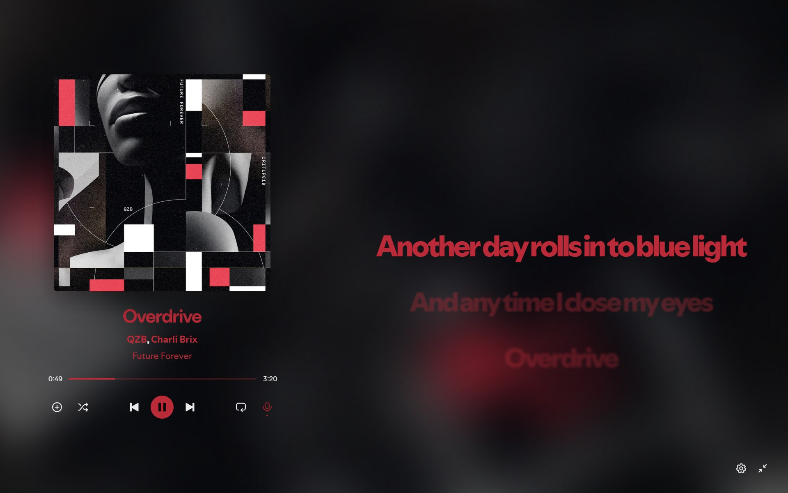
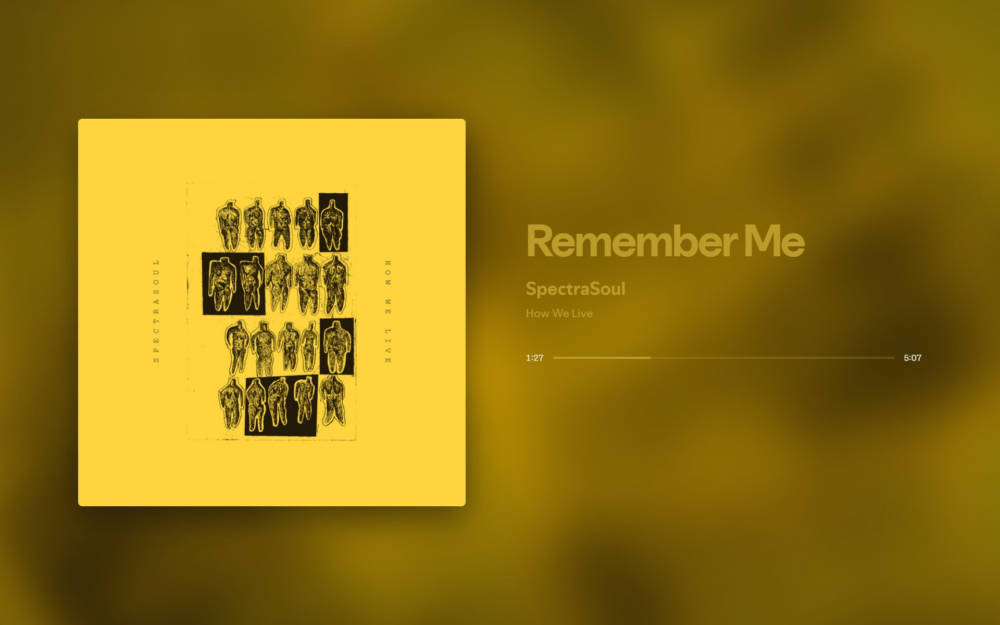
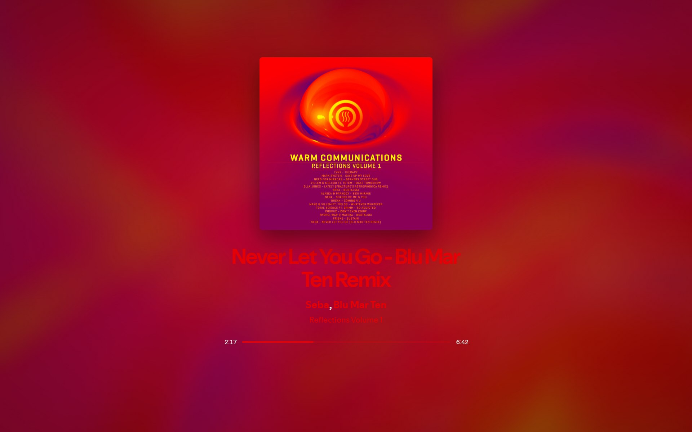
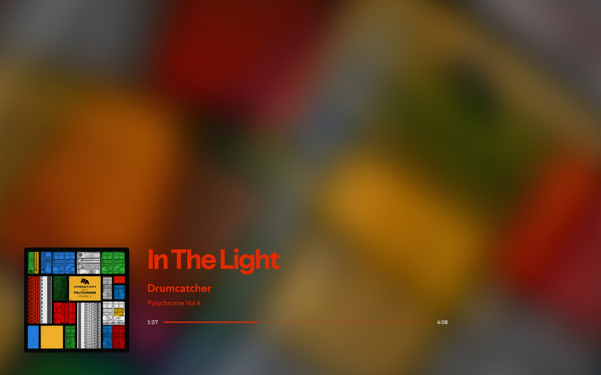
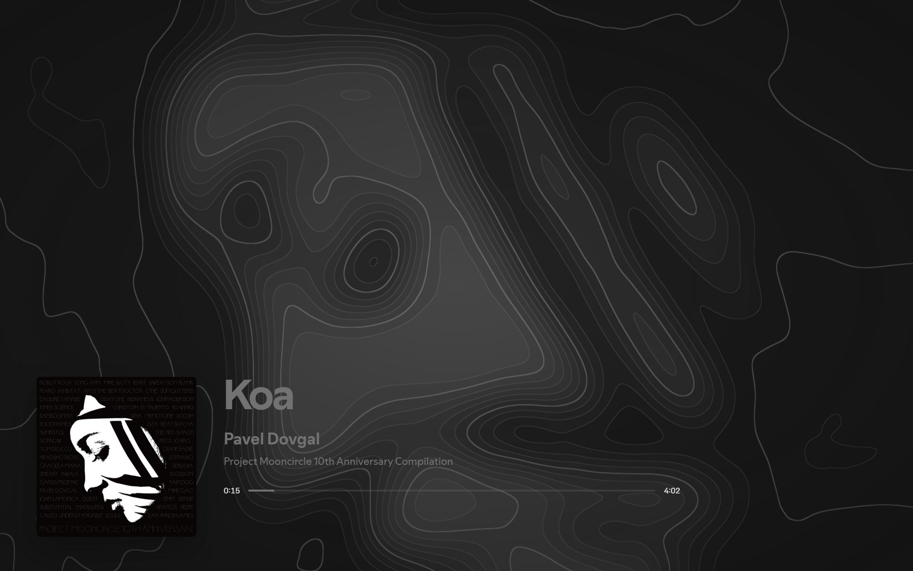
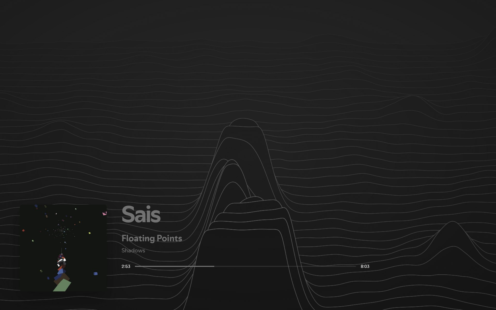
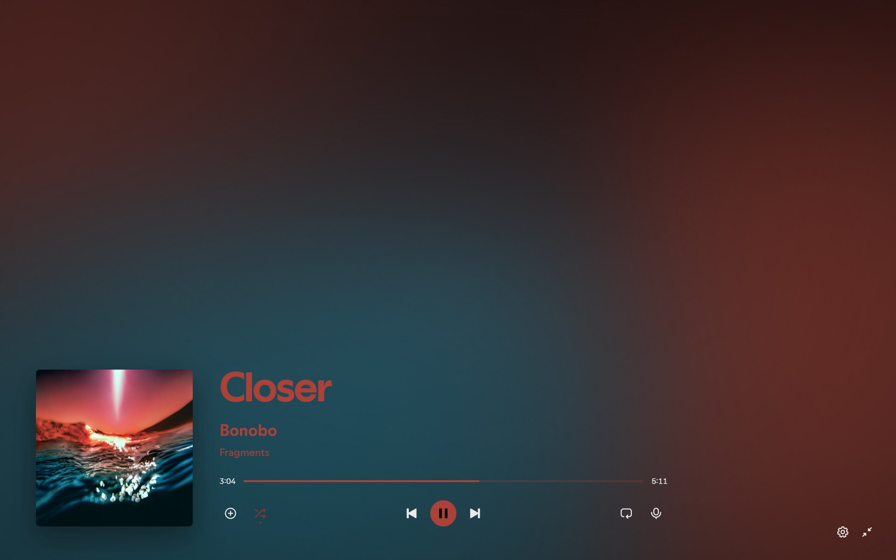
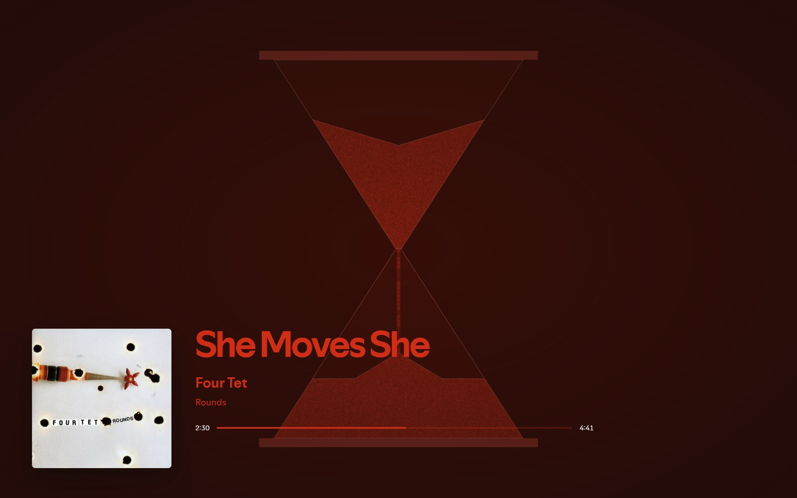
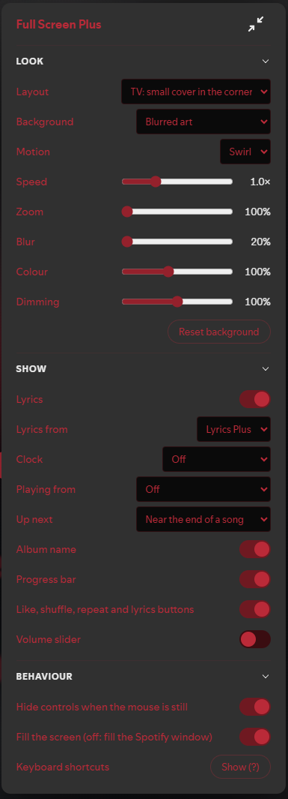

# Full Screen Plus

A full-screen "now playing" view for [Spicetify](https://spicetify.app): big cover art, an animated background made from the album art, synced lyrics, and the controls you need.



## Features

- **Three layouts:** cover beside the details, centred, or a TV-style view with a small cover in the corner
- **Moving backgrounds** made from the album art (see [Backgrounds](#backgrounds)):
  - blurred art that swirls or drifts
  - a contour map or ridgelines, shaped like the cover and in its colours
  - a soft gradient of the cover's colours
  - a sand timer that drains as the song plays and turns over for the next one
  - the artist's image, a solid colour from the art, or your theme colour

  Sliders adjust the speed, zoom, blur, colour and dimming.
- **Synced lyrics** from Spotify, or from [Lyrics Plus](https://github.com/spicetify/cli/tree/main/CustomApps/lyrics-plus) if you have it turned on
- **Up next** and **Playing from**, so you can see what's coming and where it's playing from
- **Controls:** like, shuffle and repeat, with an optional volume slider. Scroll the mouse wheel anywhere to change the volume.
- **Clickable links:** the song, artists, album and playlist each open their page in Spotify
- **Icons:** optional song, artist and album icons beside the details, shown always or only on hover
- **Clock:** optional, in 12- or 24-hour format, with or without the date
- **Gets out of the way:** the cursor and controls hide when the mouse stops moving

| Cover beside details | Centred | TV |
| --- | --- | --- |
|  |  |  |

## Backgrounds

The contour map and ridgelines take their shape from the cover, so each album gets its own landscape. Set **Terrain** to **Random** for drifting noise instead. The gradient blends the cover's main colours. The sand timer drains over the length of the song.

| Contour map | Ridgelines |
| --- | --- |
|  |  |
| **Gradient** | **Sand timer** |
|  |  |

All of them move slowly, unless your system asks for reduced motion. They need WebGL, and fall back to the blurred art without it.

Your graphics card draws them the whole time they're on screen, so on a laptop they use more battery than the blurred art. The ridgelines and the contour map are the heaviest. If they stutter or your fan gets loud, choose another background, or turn on reduced motion so they only redraw when something changes.

## Install

1. Download [`full-screen-plus.js`](full-screen-plus.js).
2. Put it in your Spicetify `Extensions` folder. To find that folder, run `spicetify path userdata` and look inside it for `Extensions`.
3. Run:
   ```
   spicetify config extensions full-screen-plus.js
   spicetify apply
   ```
4. Optional: to use Lyrics Plus as the lyrics source, also run:
   ```
   spicetify config custom_apps lyrics-plus
   spicetify apply
   ```

## Uninstall

If you installed it from Marketplace, open Marketplace, find Full Screen Plus and click **Remove**.

If you installed it yourself, run:
```
spicetify config extensions full-screen-plus.js-
spicetify apply
```
The `-` at the end takes it off your extensions list. You can then delete `full-screen-plus.js` from your `Extensions` folder.

## Use

Click the expand button at the right of the playbar, or press **F**. Press **F** or **Esc** to leave.

### Keyboard shortcuts

| Key | Action |
| --- | --- |
| Space | Play / pause |
| ← → | Back / forward 10 seconds |
| P N | Previous / next song |
| ↑ ↓ | Volume |
| M | Mute |
| S | Shuffle |
| R | Repeat |
| H | Like |
| L | Lyrics on / off |
| V | Next layout |
| B | Next background |
| , | Settings |
| ? | Show these shortcuts |
| F / Esc | Close |

### Settings

Press **,** (comma) or click the gear icon to open the settings. They're saved automatically.

<p align="center"></p>

## Requirements

Tested on Spotify 1.3.6 with Spicetify 2.46. It should work with any theme, because it takes its colours from the theme you have.

## Credits

The Lyrics Plus integration works the same way as in [daksh2k's Full Screen](https://github.com/daksh2k/Spicetify-stuff/tree/master/Extensions/full-screen), which this extension was built to replace on newer versions of Spotify.
